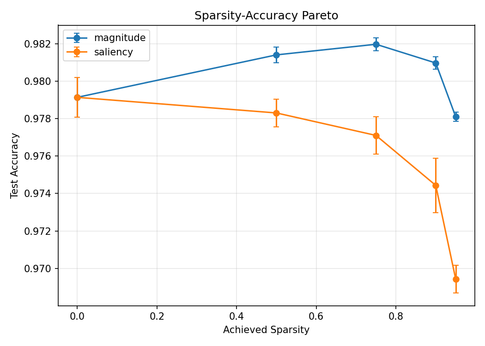

# Self-Pruning Network

A Python and NumPy implementation of reverse-mode autodiff, a composable MLP,
mask-aware Adam, and gradual global unstructured pruning on MNIST. The experiments
compare magnitude pruning (`|w|`) with first-order saliency (`|w * grad|`) under
a cubic sparsity schedule and a hard connection budget.

Scikit-learn is used **only to load MNIST**. Gradients, optimization, pruning,
data splitting, and training are implemented without neural-network or autodiff
frameworks. See [DESIGN.md](DESIGN.md) for derivations and implementation decisions.

## Quick Start

Requires Python 3.10+. Python 3.11 was used for the reference experiments.

```bash
git clone https://github.com/ANISHANGADI/self-pruning-network.git
cd self-pruning-network
python -m venv .venv
source .venv/bin/activate
python -m pip install -r requirements.txt
python -m pytest -q
```

Use `python3` if needed. On Windows PowerShell, activate with
`.venv\Scripts\Activate.ps1`. To reproduce the reference Python 3.11 dependency
versions, install [requirements-lock.txt](requirements-lock.txt) instead.
The first training run downloads MNIST and requires internet access.

## Reproduce Experiments

The default MLP is `784 -> 256 -> 128 -> 10`, with ReLU hidden layers,
He-normal weights, zero biases, and Adam at learning rate `0.001`.

Dense baseline and learning curve (5 epochs, seed 7):
```bash
python scripts/train_dense_baseline.py --epochs 5 --seed 7 --out-csv results/dense_learning_curve_seed7.csv
python scripts/plot_learning_curve.py --csv results/dense_learning_curve_seed7.csv --out plots/dense_learning_curve_seed7.png
```

Single gradual-pruning run with epoch-level metrics:
```bash
python scripts/train_self_pruning.py --criterion saliency --target-sparsity 0.90 --epochs 12 --prune-start-epoch 2 --prune-end-epoch 10 --prune-interval 100
```

Matched 8-epoch sweep, Pareto plot, and summary:
```bash
python scripts/run_pruning_sweep.py --seeds 7,13,21 --targets 0.0,0.5,0.75,0.9,0.95 --criteria magnitude,saliency --epochs 8 --batch-size 128 --lr 0.001 --prune-start-epoch 2 --prune-end-epoch 7 --prune-interval 100 --out results/pruning_sweep.csv
python scripts/plot_pareto.py --csv results/pruning_sweep.csv --out plots/sparsity_accuracy_pareto.png
python scripts/summarize_sweep.py --csv results/pruning_sweep.csv --out results/pruning_summary.csv --claim-sparsity 0.9
```

These commands overwrite the corresponding outputs; use different output paths
to preserve the reference results.

## Results

Mean test accuracy across seeds `7,13,21`, using the matched 8-epoch sweep:

| Model | Active connections | Test accuracy |
| --- | ---: | ---: |
| Dense | 234,752 | 97.9133% |
| Magnitude, 90% target sparsity | 23,475 | 98.0967% |
| Saliency, 90% target sparsity | 23,475 | 97.4433% |

**Falsifiable claim:** at 90% target sparsity, magnitude pruning outperformed
this saliency implementation by **0.6533 percentage points** on average across
these three seeds. All three paired runs favored magnitude; this does not
establish a universal ranking. Error bars show population standard deviation,
not confidence intervals.



Evidence: [raw sweep](results/pruning_sweep.csv),
[summary](results/pruning_summary.csv),
[dense learning curve](plots/dense_learning_curve_seed7.png), and
[baseline metrics](results/dense_learning_curve_seed7.csv).
The separate 5-epoch baseline is not the matched comparator in the table.

## Limitations

- At 90% sparsity, sparse-aware inference uses about 10% of dense connection
	MACs but is **13.07x slower** for magnitude and **12.57x slower** for saliency
	than dense NumPy inference in the reference measurements. No latency speedup
	is claimed; timing methodology and environment are documented in [DESIGN.md](DESIGN.md).
- Training/evaluation use dense masked matrices. Arrays remain dense in memory;
	active-weight reductions do not imply reduced allocated storage. Counts exclude biases.
- Pruning does not automatically regrow connections. Adam's tested revival
	policy resets moments while retaining its global step counter.
- Results cover one dataset and three seeds. Timings and numerical results can
	vary across hardware and dependencies. Model checkpoints are not saved.
